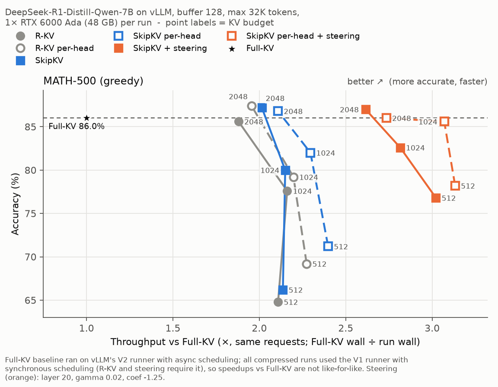
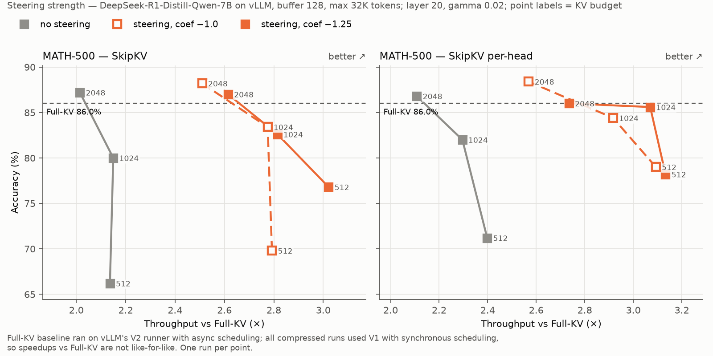
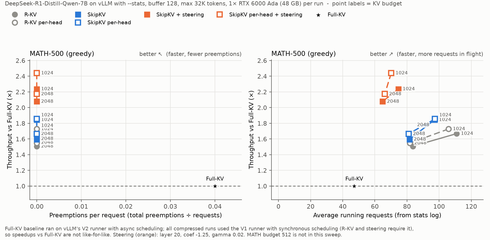

# SkipKV on vLLM (v0.25.1)

**Sentence-level KV-cache compression and activation steering for reasoning models, in vLLM v1.**

[SkipKV](https://openreview.net/pdf?id=0EsV9SIm8p) (MLSys 2026) targets the main source of waste
in long chain-of-thought: the model repeating itself. It acts at two points:

- **Skip redundant KV (sentence eviction).** Every `buffer` generated tokens, compaction keeps a
  fixed `budget` of KV entries per request. On top of R-KV's per-token importance/redundancy score,
  SkipKV detects *whole sentences* that repeat a later one (cosine similarity of mean final-layer
  hidden states) and evicts them as a unit, instead of leaving fragments behind.
- **Skip redundant generation (activation steering).** At paragraph breaks inside `<think>`, a
  SEAL "reflection" direction is subtracted from the residual stream at layer 20, more strongly
  the more often the model has said "Wait". Answers get shorter and runaway reflection loops stop.

This directory implements both on top of the [R-KV](https://arxiv.org/abs/2505.24133) port for a
**pinned** vLLM **v0.25.1**, with true physical eviction in vLLM's paged KV cache. The HuggingFace
reference implementation and the steering vectors are in the rest of this repository
([`../steering_vectors/`](../steering_vectors/)).

## Results

DeepSeek-R1-Distill-Qwen-7B, `buffer=128`, max 32K generated tokens, one RTX 6000 Ada (48 GB) per
run, evicted blocks freed. Each cell is **accuracy / throughput vs Full-KV** (Full-KV wall time ÷
run wall time, same requests). Steering uses the reference settings (layer 20, coef −1.25,
γ 0.02).

**MATH-500** (500 problems, greedy; Full-KV **86.0%**)

| Method | budget 512 | budget 1024 | budget 2048 |
| --- | --- | --- | --- |
| R-KV | 64.8% / 2.11× | 77.6% / 2.16× | 85.6% / 1.88× |
| R-KV per-head | 69.2% / 2.27× | 79.2% / 2.20× | 87.4% / 1.96× |
| SkipKV | 66.2% / 2.14× | 80.0% / 2.15× | 87.2% / 2.01× |
| SkipKV per-head | 71.2% / 2.40× | 82.0% / 2.30× | 86.8% / 2.11× |
| SkipKV + steering | 76.8% / 3.02× | 82.6% / 2.81× | 87.0% / 2.61× |
| **SkipKV per-head + steering** | **78.2% / 3.13×** | **85.6% / 3.07×** | 86.0% / 2.74× |



- **Steering is the biggest lever.** It makes answers 34–53% shorter and every run 30–41%
  faster. At tight budgets it also rescues accuracy (MATH budget 512: +7 to +11
  points, p < 10⁻⁹ for SkipKV), because compressed models otherwise loop on "Wait" until the length
  cap.
- **SkipKV per-head + steering** is the best overall: 85.6% on MATH at budget 1024 (Full-KV 86.0%)
  at 3.1× throughput.
- **Steering strength** barely matters: coef −1.0 and −1.25 are mostly within noise
  (figure below). The exception is global SkipKV at MATH budget 512, where −1.0 leaves more
  "Wait" loops (69.8% vs 76.8%); per-head gets the full gain at −1.0.



### Where the speedup comes from



The same configurations rerun with `--stats`, which records preemptions and the number of running
requests (MATH budget 512 was not rerun). Throughput here is relative to that sweep's own Full-KV
run, which was faster (2238 s vs 2817 s), so the speedups are lower than in the table.

- **Compressed runs are never preempted** (Full-KV: 20 preemptions over 500 requests).
- **The speedup is concurrency:** compressed runs keep ~80–110 requests running at once
  versus ~47 for Full-KV, whose KV cache is the limit.
- **At equal preemptions and concurrency, steering decides the speed:** answers are shorter, so
  steered runs are the fastest with only 65–75 requests in flight.

Caveats: one run per cell; MATH accuracy has about ±2 points of run-to-run noise.
**The Full-KV baseline ran on vLLM's default V2 runner with async scheduling, while every
compressed run uses the V1 runner with synchronous scheduling** (required by R-KV and steering), so
the speedups are not like-for-like; comparisons between compressed methods are. Speedups come from
memory pressure on a 48 GB GPU (more requests in flight, fewer preemptions) and from shorter
answers. Details, validation and more ablations: [`docs/skipkv/IMPLEMENTATION.md`](docs/skipkv/IMPLEMENTATION.md).

## The method in this port

| Component | What it does | Enable with |
| --- | --- | --- |
| **R-KV** (base) | Every `buffer` tokens, keep the top `budget − window` past tokens by attention importance − key redundancy, plus the last `window` tokens. | `VLLM_V1_R_KV_BUDGET`, `VLLM_V1_R_KV_BUFFER` |
| **Sentence eviction** | Segment at newline-style tokens; a sentence whose mean final-layer hidden state has cosine > threshold with a later one is penalized at compaction and evicted as a unit. | `VLLM_V1_SKIPKV_SENTENCE_THRESHOLD=0.95` |
| **Per-head granularity** | Each (layer, KV head) keeps its own top-k, as the reference does (default: one global kept set). Much better when the budget is small relative to the prompt. | `VLLM_V1_SKIPKV_GRANULARITY=head` |
| **Activation steering** | Add `(coef − γ·n_check)·v` at layer 20 on paragraph-break tokens inside `<think>` (Qwen2 architectures). Also works without compression. | `VLLM_V1_SKIPKV_STEER_VECTOR=<path>` |

How the sentence tracker survives physical compaction, runs every step without GPU syncs, and how
steering works inside a compiled, CUDA-graph-captured model is in
[`docs/skipkv/DESIGN.md`](docs/skipkv/DESIGN.md).

## Why a patch, not a fork?

The port touches vLLM in a small, additive way: one self-contained package (`skipkv/`) plus ~1010
lines of wiring across **15** existing files. Instead of vendoring the vLLM tree, this directory
ships:

```
vLLM/
├── README.md                      # you are here
├── requirements-rkv.txt           # dependency notes (adds none)
├── skipkv/                        # algo.py (R-KV), integration.py (compaction),
│                                  # sentence.py (SkipKV tracker), steering.py (SkipKV steering)
├── patch/skipkv-vllm-0.25.1.patch # wiring diff (15 upstream files)
├── scripts/apply_skipkv.sh        # clone pinned vLLM + drop in skipkv/ + apply patch
├── benchmark/                     # eval harness (GSM8K, MATH-500) + results
├── docs/                          # rkv/ (R-KV port), skipkv/ (SkipKV), REPRODUCE.md
└── tests/                         # GPU-free CPU unit tests
```

| Component | Pin |
| --- | --- |
| **vLLM** | release tag `v0.25.1` (commit `752a3a504485790a2e8491cacbb35c137339ad34`) |
| Runtime path | vLLM **v1** engine, **V1** GPU model runner (auto-selected), FlashAttention backend |
| Torch / CUDA / kernels | resolved by vLLM's own build for your platform |

## Quick start

```bash
# 1. Build the patched vLLM tree (clones v0.25.1, copies skipkv/, applies the patch).
scripts/apply_skipkv.sh

# 2. Install it. The patch is Python-only, so vLLM's precompiled kernels can be reused:
VLLM_USE_PRECOMPILED=1 pip install -e vllm-src
#    On a CUDA 12.x driver (vLLM v0.25.1 defaults to CUDA 13 wheels), install torch 2.11 from
#    the cu128 index first and add VLLM_MAIN_CUDA_VERSION=12.9 VLLM_PRECOMPILED_WHEEL_VARIANT=cu129.

# 3. Evaluate SkipKV per-head + steering on MATH-500 (budget 1024). The steering vectors ship
#    in this repository's steering_vectors/.
cd benchmark
STEER=../../steering_vectors/DeepSeek-R1-Distill-Qwen-7B/layer_20_transition_reflection_steervec.pt
RKV_MODEL=deepseek-ai/DeepSeek-R1-Distill-Qwen-7B \
VLLM_V1_R_KV_BUDGET=1024 VLLM_V1_R_KV_BUFFER=128 VLLM_V1_R_KV_FREE_BLOCKS=1 \
VLLM_V1_SKIPKV_SENTENCE_THRESHOLD=0.95 VLLM_V1_SKIPKV_GRANULARITY=head \
VLLM_V1_SKIPKV_STEER_VECTOR=$STEER \
  python eval.py --task math --n 500 --max-tokens 32768 --max-model-len 34816 --stats

# 4. ...or serve an OpenAI-compatible endpoint with the same environment variables.
#    Do NOT pass --enforce-eager: R-KV auto-selects PIECEWISE cudagraph.
VLLM_V1_R_KV_BUDGET=1024 VLLM_V1_R_KV_BUFFER=128 VLLM_V1_SKIPKV_SENTENCE_THRESHOLD=0.95 \
  vllm serve deepseek-ai/DeepSeek-R1-Distill-Qwen-7B
```

`eval.py` (`--task gsm8k|math`, `--samples K` for avg@K) prints accuracy, throughput, the
physical **compaction count** read back from the workers (proof that compression is active), the
number of steered tokens, and with `--stats` the run's total **preemptions**.

The results above are reproducible from the run summaries in
[`benchmark/skipkv_runs/`](benchmark/skipkv_runs/) (`math/`: unsteered sweep, `math_steer/`: steered
runs, `math_stats/`: `--stats` reruns). `python math/sweep.py` reruns the sweep,
`python math/summarize.py` prints the unsteered rows of the MATH-500 table, and
`bash math/regen_figs.sh` redraws the three figures (run from `benchmark/skipkv_runs/`).

## Configuration (environment variables)

**R-KV base** — compression is active once `BUDGET` and `BUFFER` are both > 0; otherwise every
code path is inert.

| Variable | Default | Meaning |
| --- | --- | --- |
| `VLLM_V1_R_KV_BUDGET` | `0` (off) | KV entries kept per request after compression |
| `VLLM_V1_R_KV_BUFFER` | `0` (off) | compress every N generated tokens |
| `VLLM_V1_R_KV_WINDOW` | `8` | trailing observation window (always retained) |
| `VLLM_V1_R_KV_KERNEL` | `7` | max-pool kernel size for the importance term |
| `VLLM_V1_R_KV_FREE_BLOCKS` | `0` | free the blocks compaction evicts (bounded footprint at `budget + buffer`); **required for long outputs**, otherwise the cache fills and preempted requests are left uncompressed |
| `VLLM_V1_R_KV_SCORE_CHUNK_MB` | `512` | scoring-memory cap; set `2048` for budgets ≥ ~2.5K or long requests silently stay Full-KV |
| `VLLM_V1_R_KV_ASYNC` | `0` | allow async scheduling with R-KV (not with steering) |

**SkipKV sentence eviction**

| Variable | Default | Meaning |
| --- | --- | --- |
| `VLLM_V1_SKIPKV_SENTENCE_THRESHOLD` | `0` (off) | cosine threshold for a redundant sentence pair (paper: 0.95) |
| `VLLM_V1_SKIPKV_GRANULARITY` | `global` | `head` = per-(layer, KV head) kept sets, as the reference |
| `VLLM_V1_SKIPKV_SENTENCE_KEEP` | `last` | `first` = penalize the later copy instead |
| `VLLM_V1_SKIPKV_SENTENCE_PRUNE` | `1` | drop sentences with no cached token from the comparison pool |

**SkipKV activation steering** (Qwen2-architecture models; forces the V1 runner and synchronous
scheduling)

| Variable | Default | Meaning |
| --- | --- | --- |
| `VLLM_V1_SKIPKV_STEER_VECTOR` | unset (off) | path of the steering vector (enables steering) |
| `VLLM_V1_SKIPKV_STEER_LAYER` | `20` | decoder layer whose input is steered |
| `VLLM_V1_SKIPKV_STEER_COEF` | `-1.25` | initial coefficient |
| `VLLM_V1_SKIPKV_STEER_GAMMA` | `0.02` | coefficient change per sentence containing a check word |
| `VLLM_V1_SKIPKV_STEER_REFRESH` | `128` | coefficient refresh interval (the reference's `divide_length`) |

Steering vectors for R1-Distill-Llama-8B, -Qwen-7B and -Qwen-14B ship in this repository's
[`steering_vectors/`](../steering_vectors/); only the Qwen2 architecture is wired here.

## Multi-GPU

R-KV and SkipKV work with **tensor** and **data parallelism** (`--tensor-parallel-size` /
`--data-parallel-size`). Under TP, R-KV all-reduces its eviction scores so every rank evicts the
identical set (per-head eviction is rank-local). DP replicas are independent. Pipeline parallelism
is not supported. Validation: [`docs/rkv/OPTIMIZATIONS.md`](docs/rkv/OPTIMIZATIONS.md#validation-record).

## Tests

```bash
# GPU-free CPU unit tests: R-KV bit-parity, compaction, the SkipKV sentence tracker, per-head
# eviction, and steering (checked against a literal re-implementation of the reference).
# Run each module in its own process: with a real vLLM installed, loading several in one
# process registers vLLM's custom ops twice.
cd tests && for t in test_rkv_algo test_rkv_integration test_skipkv test_rkv_per_head test_steering; do
  python -m unittest $t; done
```

## More results

- [`docs/skipkv/IMPLEMENTATION.md`](docs/skipkv/IMPLEMENTATION.md) §10 — H100 results: R-KV /
  SkipKV / per-head on GSM8K and MATH-500.

## Documentation

See [`docs/README.md`](docs/README.md) for the index.

**SkipKV** ([`docs/skipkv/`](docs/skipkv/))

- [`DESIGN.md`](docs/skipkv/DESIGN.md) — SkipKV design decisions for vLLM.
- [`IMPLEMENTATION.md`](docs/skipkv/IMPLEMENTATION.md) — SkipKV details: variants, granularity,
  steering, configuration, results, validation, known limitations.

**R-KV base** ([`docs/rkv/`](docs/rkv/))

- [`DESIGN.md`](docs/rkv/DESIGN.md) — the R-KV port and its core design tension.
- [`IMPLEMENTATION.md`](docs/rkv/IMPLEMENTATION.md) — per-step data flow and the exact wiring points
  in v0.25.1.
- [`OPTIMIZATIONS.md`](docs/rkv/OPTIMIZATIONS.md) — performance work, limitations, roadmap.
- [`RESIDUAL_GAP_INVESTIGATION.md`](docs/rkv/RESIDUAL_GAP_INVESTIGATION.md) — the async-scheduling
  KV-corruption investigation.

**Both:** [`docs/REPRODUCE.md`](docs/REPRODUCE.md) — how the shared patch was generated and how to
regenerate it.
